# Database Design — Support Ticket Management System

## 1. Overview & Rationale

This project uses **MongoDB** with **Mongoose ODM**. Rather than embedding comments and activity logs directly inside `Ticket` documents (which can grow unbounded and hit MongoDB's 16MB document size limit), we use **normalized `ObjectId` references** across five collections. This gives us:
- Fast, indexed queries on tickets, comments, and notifications.
- Clean auditability via an append-only `ActivityLog` collection.
- Flexible `metadata` storage for domain events.

---

## 2. Entity-Relationship Diagram

```mermaid
erDiagram
    USER ||--o{ TICKET : "creates (createdBy)"
    USER ||--o{ TICKET : "assigned (assignedTo)"
    USER ||--o{ COMMENT : "authors"
    USER ||--o{ ACTIVITY_LOG : "performs (actor)"
    USER ||--o{ NOTIFICATION : "receives (recipient)"
    TICKET ||--o{ COMMENT : "has"
    TICKET ||--o{ ACTIVITY_LOG : "records"
    TICKET ||--o{ NOTIFICATION : "triggers"

    USER {
        ObjectId _id PK
        string name
        string email UK
        string password
        enum role "user | admin"
        boolean isActive
        date createdAt
        date updatedAt
    }

    TICKET {
        ObjectId _id PK
        string ticketNumber UK "TKT-XXXXXX"
        string title
        string description
        enum category "technical | billing | account | feature_request | bug | other"
        enum priority "low | medium | high | urgent"
        enum status "open | in_progress | resolved | closed"
        ObjectId createdBy FK
        ObjectId assignedTo FK
        date resolvedAt
        date createdAt
        date updatedAt
    }

    COMMENT {
        ObjectId _id PK
        ObjectId ticket FK
        ObjectId author FK
        string body
        date createdAt
        date updatedAt
    }

    ACTIVITY_LOG {
        ObjectId _id PK
        ObjectId ticket FK
        ObjectId actor FK
        enum event "ticket.created | ticket.updated | ticket.status_changed | comment.added | ticket.resolved"
        string description
        mixed metadata
        date createdAt
    }

    NOTIFICATION {
        ObjectId _id PK
        ObjectId recipient FK
        ObjectId ticket FK
        string event
        string message
        boolean isRead
        date createdAt
    }
```

---

## 3. Collection Schemas & Indexing Strategy

### `users`
- **Unique Index**: `{ email: 1 }`
- **Security**: `password` has `select: false` so it is never returned in queries unless explicitly selected during login, and `toJSON` strips `password` and `__v`. Passwords are hashed using `bcryptjs` (salt rounds: 12) in a `pre('save')` hook.

### `tickets`
- **Unique Index**: `{ ticketNumber: 1 }` (auto-generated `TKT-XXXXXX` before validation).
- **Compound Indexes**:
  - `{ createdBy: 1, status: 1, createdAt: -1 }` — optimizes user-scoped ticket listings and status filters.
  - `{ status: 1, priority: 1, createdAt: -1 }` — optimizes Admin queue filtering and triage sorting.
- **Text Index**: `{ title: 'text', description: 'text', ticketNumber: 'text' }` — supports keyword search.

### `comments`
- **Compound Index**: `{ ticket: 1, createdAt: 1 }` — retrieves ticket conversation threads in chronological order.

### `activitylogs`
- **Compound Index**: `{ ticket: 1, createdAt: -1 }` — retrieves the audit timeline for any ticket in reverse chronological order, and powers the Admin dashboard's recent system events feed.

### `notifications`
- **Compound Index**: `{ recipient: 1, isRead: 1, createdAt: -1 }` — powers fast unread notification counts and dropdown feeds per user.
